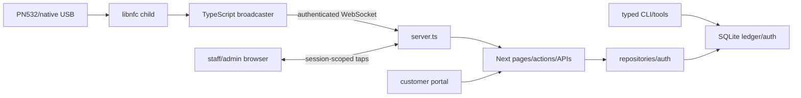

# Development Guide

The Student Council Payment System uses one TypeScript package for the web server, administrative CLI, NFC readers and operational tools.

## Toolchain

- Node.js `>=26.13.1 <27`; containers pin `26.13.1`.
- pnpm `12.21.0`, TypeScript `7.0.2`, tsx `4.23.15`.
- Next.js `16.4.6`, React `19.3.1`, Tailwind CSS 4, Radix/Shadcn components, React Hook Form and Zod.
- `better-sqlite3` for the ledger/auth database; `ws` for NFC transport.
- Native libnfc for documented PN532 UART/I2C and libnfc-supported USB readers.
- `csv-parse` and `tar-stream` for complete CSV/archive parsing.

Python is not an application or reader runtime. Python >=3.11 and a C/C++ toolchain may still be required to compile third-party native addons. There is no repository Python requirements file or venv/pip setup.

## Architecture



Remote tap nodes do not need access to the ledger file. Broadcasters authenticate separately from staff browser subscriptions. Network presence is not proof that a reader is communicating with a card.

The custom server and bundled Next handlers share one `Symbol.for`-anchored tap broadcaster and reader registry. Do not add a second emitter or cleanup interval. Socket delivery rechecks the original signed session's current database role and expiry.

## Source Map

- `scps-cli`, `scps-remote-cli`: minimal package-cwd launchers.
- `scripts/setup-debian.sh`: only the OS/Node/pnpm/native-build bootstrap.
- `migrations/schema.sql`, `web-next/migrations/better_auth_schema.sql`: final ledger/auth schemas.
- `web-next/server.ts`: HTTP, Next handler, authenticated WebSockets and shutdown.
- `web-next/app/(app)/admin/`: protected operator pages/layout.
- `web-next/app/(customer)/customer/`: owned buyer portal/pending state.
- `web-next/app/actions/`: authorized, validated server mutations.
- `web-next/app/api/`: authentication, transaction, NFC and administrative endpoints.
- `web-next/lib/`: auth/session guards, canonical paths, schema validation, cents and repositories.
- `web-next/hardware/`: native reader adapter, broadcaster and diagnostics.
- `web-next/tools/`: CSV, snapshots/extraction and maintenance conversions.
- `web-next/tools/ops/`: one typed entrypoint per operational workflow.
- `web-next/tests/`: disposable real-server tests and legacy fixtures.
- `systemd/`: rendered Node/tsx service templates.

### Routes and Roles

`admin | staff | customer` are the only roles. A teacher who only buys is a customer, not a separate role.

- `/admin`: shared staff/admin dashboard.
- `/admin/customers[/id]`, `/admin/transactions`, `/admin/pos`, `/admin/topup`: operator pages.
- `/admin/users`, `/admin/payments`: administrator-only account/payment decisions.
- `/customer`, `/customer/pending`: owned buyer account or pending approval.
- `/login`, `/signup`: public authentication.
- Existing `/api/*` URLs remain unchanged.

The home page dispatches by fresh session/link state. Legacy page GET/HEAD URLs redirect permanently with suffix/query values preserved; POST actions are not redirected. Hiding navigation is not authorization: enforce role and ownership inside every action/API.

### Ledger Invariants

Financial rows use `customers`, `customer_id` and `user_customer_links`. Money is integer cents (`100` means ¥1.00), including balances, transaction amounts, weekly overdraft usage and payment reservations.

Use repositories for ledger operations and existing currency helpers at display/input boundaries. Keep checkout and reviewed credit atomic. A claim does not credit; receipt-confirmed administrator approval credits the base amount once. Top-ups do not refund previously consumed weekly borrowing allowance.

Ordinary startup validates the final schema and cent scale; it never silently migrates old/mixed schemas or converts money. See [Database Guide](database.md) before changing an existing ledger.

## Local Setup

Follow [Getting Started](getting-started.md) for fresh core/auth initialization and explicit first-administrator provisioning. Keep an existing database and secrets; do not initialize over them.

```bash
cd web-next
pnpm install --frozen-lockfile
cp .env.local.example .env.local   # only when it does not already exist
# Configure DATABASE_PATH, a generated BETTER_AUTH_SECRET, app URL and origins.
pnpm dev
```

Configured relative `DATABASE_PATH` values resolve against `web-next`, independent of the launch directory. Quote paths containing spaces in `.env.local`.

The root CLI launchers resolve the package directory themselves:

```bash
./scps-cli --help
./scps-remote-cli --help
```

Direct TypeScript entrypoints run from the package with `node --import tsx`. Do not rely on an unpinned downloaded runner.

## NFC Development

Start the actual web server, sign in as staff/admin and open `/admin/pos`. Configure the shared broadcaster secret in the server and reader environment, then:

```bash
cd web-next
node --import tsx tools/ops/run-nfc.ts --simulate
# Enter a UID only after authentication; q/quit/exit or EOF stops simulation.
node --import tsx tools/ops/test-nfc.ts --url http://localhost:3000 --lane reader-1
```

The test command sends `DEADBEEF`; simulation does not prove physical reader acceptance. Exact device selection, native calibration, dual-reader services and safe stop/reset/start procedures are in [NFC Setup](nfc-setup.md).

The native adapter owns its child through close. Cancellation must terminate/reap it before another read and must never publish an old generation's UID. Preserve the 100ms spacing, 1.5-second debounce and independent network/hardware backoffs.

## Verification and Build

From `web-next`:

```bash
pnpm test
pnpm exec tsc --noEmit
pnpm lint
pnpm build
pnpm start
```

`pnpm test` selects only `*.test.ts`, then runs the CLI self-check. Do not use bare `node --test`: retained production diagnostic filenames also begin with `test-`/`test_`.

Focused checks should name their test files. Use disposable ledgers, fake privileged executables and local rclone aliases. Never verify by resetting real USB devices, mutating host services, deploying over SSH or accessing a production/cloud ledger.

Container builds use repository-root context and an isolated build database:

```bash
podman build -f web-next/Dockerfile -t scps:local .
```

See [Deployment Guide](deployment.md) for nonroot writable mounts, runtime secrets and HTTPS. Builder Python for native dependencies is separate from the Python-free application runtime.

## Extending the System

1. Define/validate data in the existing models and repository layer.
2. Keep schema changes explicit, backed up and transactionally validated; migrate every owned caller/fixture together.
3. Add role/ownership checks inside server actions/APIs, not just components.
4. Put operator pages below the protected admin layout and customer-owned pages below the customer layout.
5. Revalidate canonical routes after successful mutations.
6. Keep native commands argument-array based, propagate failures/signals and preserve owned-child cleanup.

Prefer the surrounding house components/helpers and one implementation over wrappers or aliases. Use type imports, strict message/row types and validated trust boundaries; do not add untyped compatibility modules.

## UI components

Shared controls are in `web-next/components/ui/`; project components are in
`web-next/components/`. The protected operator layout mounts `TapAlert` inside
`NFCReaderProvider`; outside POS, taps open a drawer. The customer layout is
separate. The admin POS `PosForm` accepts `customerIdsWithTransactions`,
`userName` and `initialMode`; `TopupForm` accepts `customerIdsWithTransactions`
and `userName`.

`WeeklyTopupChart` is a named export from
`web-next/components/weekly-topup-chart.tsx`. It renders an area chart from
its `data` input. Use the existing currency helpers in `web-next/lib/` for
money display and input. Forms use the patterns of their surrounding code;
not all forms use React Hook Form.

The root layout uses `components/theme-provider.tsx`, a theme cookie and
`lib/theme-bootstrap.ts` to initialize the theme before hydration.

Keep commit subjects short, lowercase and prefix-free like the existing history. Commit each verified implementation chunk.

## Further Reading

- [Testing Guide](testing.md)
- [Scripts Reference](scripts.md)
- [Authentication Guide](authentication.md)
- [UI components](#ui-components)
- [Security Guide](security-guide.md)

**Last updated: November 15, 2026**
